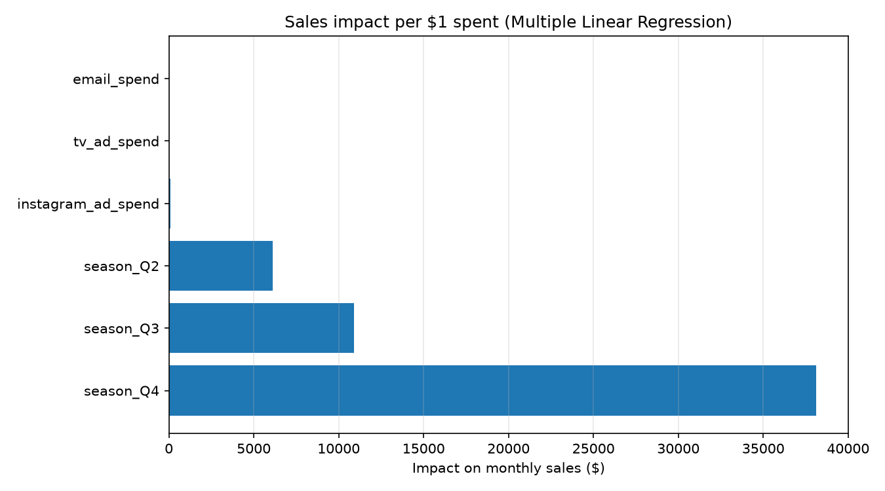

# Sales Forecasting with Linear Regression


> **Business question:** *"If we spend more on Instagram ads, how much will sales increase?"*

A machine learning project that answers a common revenue question by fitting a
**linear regression** model to 8 years of monthly marketing data. It quantifies
the return on every advertising dollar and lets the company forecast sales for
any budget.

---

## Key results

| Finding | Value |
|---|---|
| **Sales gained per $1 of Instagram ad spend** | **+$82.15** |
| Model explains sales variance (R²) | 0.988 |
| Average prediction error (MAE) | ~$7,900/month |
| Model | `sales = 7,521.15 + 82.15 × ad spend` |


**Answer to the business question:** every $1 spent on Instagram ads returns
~$82 in sales on average. At $3,500/month in ads, predicted sales are ~$295k/month.

---

## How it works

1. **Data** — 96 months of simulated `instagram_ad_spend` and `sales`.
2. **Split** — 80% training / 20% test (`train_test_split`, `random_state=42`).
3. **Model** — `sklearn.linear_model.LinearRegression`, a straight line
   `sales = intercept + slope × ad_spend`.
4. **Evaluate** — R², MAE and RMSE on held-out data.
5. **Predict** — input any ad spend, get an expected sales figure.

The same story is shown step-by-step in [`sales_forecast.ipynb`](sales_forecast.ipynb).

---

## Stage 2: Multi-channel forecasting & model comparison

Stage 1 used a single feature. Stage 2 adds **TV ads, email spend and seasonality**, compares four model families with **5-fold cross-validation**, exports the winner with `joblib`, and serves it from a **Streamlit app**.

### Models compared (5-fold CV)

| Model | CV R² | CV MAE ($) |
|---|---|---|
| **Multiple Linear Regression** | **0.947** | **19,311** |
| Ridge Regression | 0.944 | 20,498 |
| Polynomial Regression (deg 2) | 0.925 | 21,938 |
| Random Forest | 0.919 | 24,599 |

The simplest model wins, and because it is linear it stays **interpretable**:



| Channel | Sales per $1 spent (~) |
|---|---|
| Instagram ads | **+$94** |
| TV ads | +$3.13 |
| Email spend | +$2.42 |
| Seasonality (Q4 vs Q1) | +$38k/month |

**Key insight:** marketing money is not equal across channels — Instagram
dominates return per dollar. This is the kind of finding that drives real budget
decisions.

### Run Stage 2

```bash
python generate_multi_data.py      # build the multi-channel dataset
python model_comparison.py         # compare models, export best to output/sales_model.joblib
streamlit run app.py               # interactive prediction app
```

Full walkthrough: [`model_comparison.ipynb`](model_comparison.ipynb).

---

## Project structure

```
sales-regression/
├── data/
│   ├── sales_data.csv            # single-feature dataset (Stage 1)
│   └── sales_data_multi.csv      # multi-channel dataset (Stage 2)
├── output/
│   ├── regression_plot.png       # Stage 1 regression line
│   ├── coeffs_plot.png           # Stage 2 channel impact chart
│   └── sales_model.joblib        # exported best model for app.py
├── sales_forecast.ipynb          # Stage 1 walkthrough notebook
├── model_comparison.ipynb        # Stage 2 comparison notebook
├── sales_forecast.py             # Stage 1 script
├── model_comparison.py           # Stage 2 comparison script
├── generate_data.py              # Stage 1 data generator
├── generate_multi_data.py        # Stage 2 data generator
├── app.py                        # Streamlit app serving sales_model.joblib
├── requirements.txt
└── README.md
```

---

## Run it (Stage 1)

```bash
pip install -r requirements.txt
python generate_data.py      # optional — data/sales_data.csv is already included
python sales_forecast.py
```

It prints the metrics and equation, then asks you for an ad spend and returns a
predicted sales figure. A plot is saved to `output/regression_plot.png`.

### Example output

```
sales = 7,521.15 + 82.15 * instagram_ad_spend

Interpretation: for every extra $1 spent on Instagram ads,
sales increase by about $82.15 on average.

If you spend $3,500/month on Instagram ads, predicted sales: $295,030.24/month
```

---

## Interview talking points

Stage 1 (single feature):

- Why train/test split? It measures performance on data the model has never seen,
  not memorized data.
- Why R²? It says *how much of sales variation the ad spend alone explains* (98.8% here).
- The **slope**, not the RMSE, is the business answer: it converts model output
  into a budget decision ($1 → $82).
- Practical judgment: simulation is noise-free enough to give near-perfect fit;
  with real data, an R² of 0.5–0.7 would already be a useful marketing signal.

Stage 2 (model comparison):

- **Why cross-validation instead of one split?** It averages performance over 5
  partitions, so the ranking is not a lucky sample.
- **Why compare multiple families?** Simplicity revealed: linear beat Random
  Forest on this small, mostly-linear dataset.
- Interpretability is a business asset: coefficients become a budget-allocation
  recommendation.