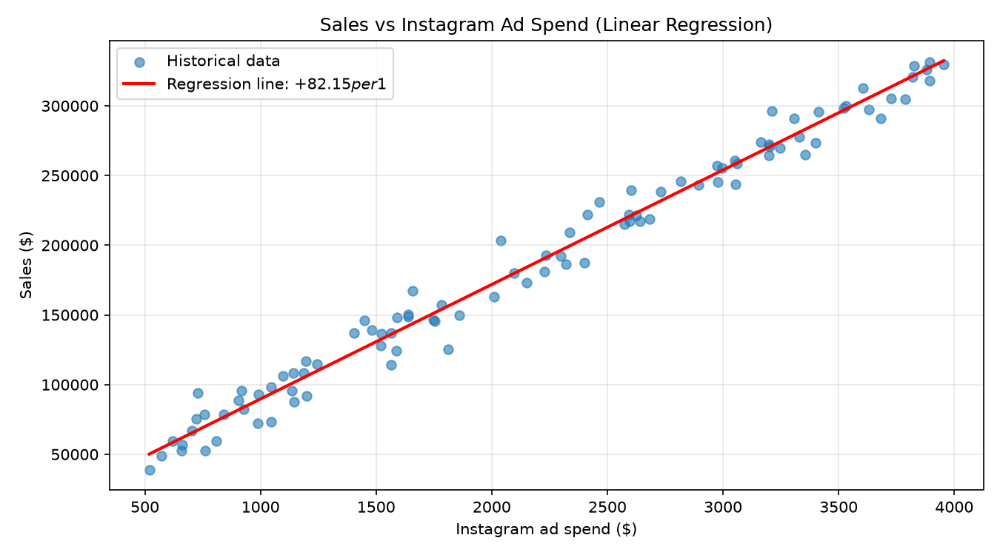

# Sales Forecasting with Linear Regression


> **Business question:** *"If we spend more on Instagram ads, how much will sales increase?"*

A machine learning project that answers a common revenue question by fitting a
**linear regression** model to 8 years of monthly marketing data. It quantifies
the return on every advertising dollar and lets the company forecast sales for
any budget.

---

## Key results

| Finding | Value |
|---|---|
| **Sales gained per $1 of Instagram ad spend** | **+$82.15** |
| Model explains sales variance (R²) | 0.988 |
| Average prediction error (MAE) | ~$7,900/month |
| Model | `sales = 7,521.15 + 82.15 × ad spend` |



**Answer to the business question:** every $1 spent on Instagram ads returns
~$82 in sales on average. At $3,500/month in ads, predicted sales are ~$295k/month.

---

## How it works

1. **Data** — 96 months of simulated `instagram_ad_spend` and `sales`.
2. **Split** — 80% training / 20% test (`train_test_split`, `random_state=42`).
3. **Model** — `sklearn.linear_model.LinearRegression`, a straight line
   `sales = intercept + slope × ad_spend`.
4. **Evaluate** — R², MAE and RMSE on held-out data.
5. **Predict** — input any ad spend, get an expected sales figure.

The same story is shown step-by-step in [`sales_forecast.ipynb`](sales_forecast.ipynb).

---

## Project structure

```
sales-regression/
├── data/
│   └── sales_data.csv        # 96 months of simulated history
├── output/
│   └── regression_plot.png   # scatter plot + regression line (generated)
├── sales_forecast.ipynb      # walkthrough notebook (recruiter-friendly)
├── sales_forecast.py         # script version of the same pipeline
├── generate_data.py          # recreates data/sales_data.csv
├── requirements.txt
└── README.md
```

---

## Run it

```bash
pip install -r requirements.txt
python generate_data.py      # optional — data/sales_data.csv is already included
python sales_forecast.py
```

It prints the metrics and equation, then asks you for an ad spend and returns a
predicted sales figure. A plot is saved to `output/regression_plot.png`.

### Example output

```
sales = 7,521.15 + 82.15 * instagram_ad_spend

Interpretation: for every extra $1 spent on Instagram ads,
sales increase by about $82.15 on average.

If you spend $3,500/month on Instagram ads, predicted sales: $295,030.24/month
```

---

## Interview talking points

- Why train/test split? It measures performance on data the model has never seen,
  not memorized data.
- Why R²? It says *how much of sales variation the ad spend alone explains* (98.8% here).
- The **slope**, not the RMSE, is the business answer: it converts model output
  into a budget decision ($1 → $82).
- Practical judgment: simulation is noise-free enough to give near-perfect fit;
  with real data, an R² of 0.5–0.7 would already be a useful marketing signal.

## Ideas to extend

- Multiple linear regression (add TV ads, email spend, seasonality).
- Compare against Ridge / Polynomial / Random Forest.
- `cross_val_score` for more robust metrics.
- Export with `joblib` and serve predictions behind a tiny API or Streamlit app.